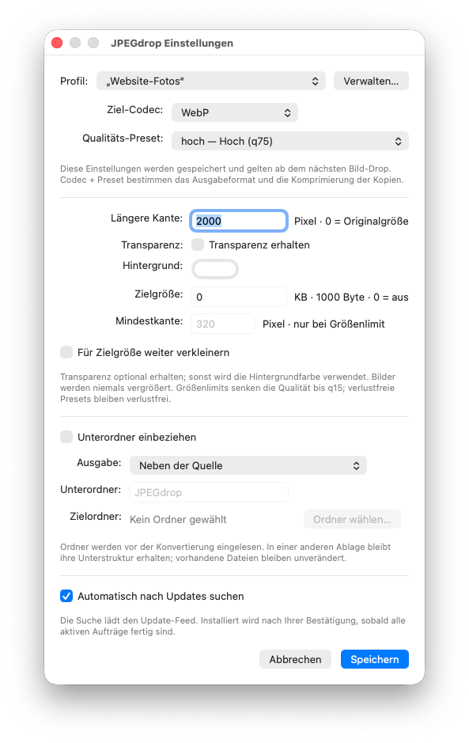

# JPEGdrop

**🌐 Sprache / Language:** [English](README.md) · [Deutsch](README.de.md)

JPEGdrop erzeugt aus Bildern auf seinem macOS-Dock-Icon kleinere, metadatenfreie JPEG-, PNG-, AVIF- oder WebP-Kopien, standardmäßig neben den Originalen.

## Installieren und verwenden

1. Das DMG unter [Releases](https://github.com/danielmuellerir/jpegdrop/releases) herunterladen.
2. JPEGdrop nach Programme ziehen und öffnen. Python und Homebrew sind nicht nötig.
3. Im **JD**-Menü oder unter **Einstellungen…** (⌘,) ein Profil oder Codec und Preset wählen.
4. Bilder oder Ordner auf das Dock- oder Finder-Icon der App ziehen.

Die Oberfläche ist deutsch. Standard ist **JPEG · hoch** (Qualität 85).
JPEGdrop wird ausschließlich für Apple Silicon gebaut. Das Bundle weist macOS
12.0 als Mindestversion aus; Release-Tests liefen auf macOS 26.7.1. Die Ausführung
auf macOS 12 ist noch nicht belegt. Getestete Systeme stehen in den Release Notes.



## Dateien und Bildverarbeitung

Originale werden weder verändert noch überschrieben. Die Kopien liegen daneben:

| Quelle | JPEG-Ausgabe |
|---|---|
| `foto.heic` oder `foto.png` | `foto.jpg` |
| `foto.jpg` | `foto-klein.jpg` |
| Ein Zielname existiert bereits | `foto-2.jpg`, dann `foto-3.jpg` usw. |

HEIC/HEIF, JPEG, PNG, TIFF, WebP, AVIF und weitere von Pillow unterstützte
Einzelbilder lassen sich einlesen. HEIC ist ein Eingabeformat; JPEGdrop erzeugt
keine HEIC-Dateien.

- EXIF-Orientierung wird eingerechnet, bevor eingebettete EXIF-/GPS-/ICC-Daten entfernt werden.
- Unterstützte Farbprofile werden nach sRGB umgerechnet. Ungültige oder nicht
  zum Bild passende Profile führen zu einem Fehler statt zu ungeprüfter Ausgabe.
- PNG, AVIF und WebP können Transparenz erhalten. Standardmäßig wird sie auf
  Weiß gelegt; die Hintergrundfarbe lässt sich in den Einstellungen wählen.
  JPEG entfernt Transparenz immer. Eine Warnung nennt betroffene Bilder.
- Eine maximale Bildkante verkleinert optional proportional mit Lanczos, nach
  dem Einrechnen der Orientierung. Kleine Bilder werden niemals vergrößert.
- Animationen und Mehrbilddateien werden abgewiesen. Das erste Bild wird nicht
  unbemerkt als Einzelbild exportiert.
- Dateinamen, Dateisystem-Zeitstempel und sichtbare Bildinhalte werden nicht anonymisiert.

JPEG, AVIF und WebP bieten sechs feste Qualitätsstufen sowie **auto**. Auto passt
die Qualität an die längere Kante des vorbereiteten Bildes an, nach optionaler Verkleinerung.
PNG bietet verlustfreie Kodierung oder eine reduzierte Palette mit 256 Farben.
„Verlustfrei“ beschreibt die PNG- oder WebP-Kodierung nach den gewählten Farb-,
Transparenz- und Größenoptionen; diese Vorbereitung kann die Quellpixel ändern.
WebP bietet ein echtes verlustfreies Preset, das alle vorbereiteten Pixel auch
in transparenten Bereichen erhält. Das PNG-Preset mit 256 Farben kann Farb-
und Alphastufen reduzieren.
Auch das höchste JPEG-Preset arbeitet verlustbehaftet. Schon optimierte Bilder
können größer werden; Dateigrößen und Warnungen werden entsprechend angezeigt.

## Ordner und Ausgabeablage

Ordnerdrops erfassen Bilder auf der obersten Ebene. **Unterordner einbeziehen**
aktiviert verschachtelte Ordner. JPEGdrop erstellt das Inventar vor der
Konvertierung und überspringt symbolische Links, doppelte Dateien, App-Pakete
und verwaltete Fotomediatheken. Ungeeignete Einträge werden gemeldet. Die
Inventur ist auf 10.000 Bilder und höchstens 50.000 untersuchte Dateien/Ordner
begrenzt; eine Überschreitung beendet den Auftrag vor der Konvertierung.

Die Ausgabeablage lässt sich in den Einstellungen wählen:

| Einstellung | Beispiel für `Album/Unterordner/foto.png` als JPEG |
|---|---|
| Neben der Quelle (Standard) | `Album/Unterordner/foto.jpg` |
| Ausgabe-Unterordner `JPEGdrop` | `Album/JPEGdrop/Unterordner/foto.jpg` |
| Gewählter Zielordner `Exporte` | `Exporte/Album/Unterordner/foto.jpg` |

Einzeldateien landen direkt im Zielordner oder im Unterordner ihres
Quellverzeichnisses. Die Ordnerstruktur bleibt erhalten. Ein gewähltes Ziel im
Quellbaum wird beim Einlesen ausgelassen. Andere vorhandene Bilder bleiben
Eingaben, auch frühere Konvertierungen. Bei Kollisionen wird hochgezählt;
Quellen und bestehende Ausgaben bleiben unverändert. Bei überlappenden
Eingaben zählt das erste Vorkommen.

## Dateigrößengrenze

**Zielgröße** begrenzt optional die tatsächlichen Bytes jeder Ausgabedatei.
In den Einstellungen gilt KB = 1000 Byte; null deaktiviert das Limit. JPEG,
AVIF und verlustbehaftetes WebP prüfen ab der gewählten Preset-Qualität
abwärts bis q15. Der erste passende Kandidat wird verwendet; jede höhere
Qualität wird tatsächlich geprüft. Eine streng monotone Dateigröße wird
nicht vorausgesetzt. PNG und verlustfreies WebP behalten ihr Kodierverfahren.
Das ältere `--quality` bleibt exakt.

Die gewählten Bildmaße haben Vorrang. Weiteres Verkleinern erfordert
**Für Zielgröße weiter verkleinern** und eine Mindestkante (Standard 320 Pixel).
Geprüft werden höchstens vier Größen und 81 Qualitätsstufen je Größe. Jeder
Kandidat entsteht aus derselben vorbereiteten Pixelbasis. Die Suche zeigt
Fortschritt und lässt sich abbrechen. Passt kein erlaubter Kandidat, meldet
JPEGdrop `target_size_unreachable` und erzeugt keine Ausgabe. Eine zu große
Datei wird nie stillschweigend als Erfolg veröffentlicht.

## Benannte Profile

Profile enthalten alle Bild- und Ablageoptionen einschließlich Unterordnerwahl.
Update-Einstellungen gelten global. Bestehende Einstellungen behalten ihre Werte
und erscheinen zunächst als **Benutzerdefiniert**. Die editierbaren Startprofile:

| Profil | Optionen |
|---|---|
| Mail | JPEG q85, höchstens 1600 px und 500.000 Byte; das Limit darf die Qualität bis q15 senken, ohne weiteres Verkleinern |
| Website-Fotos | WebP q75, höchstens 2000 px, kein Größenlimit |
| Screenshots | Verlustfreie PNG-Kodierung, Originalmaße, Transparenz erhalten |

Alle Startprofile schreiben neben die Quelle und beziehen keine Unterordner ein.
Bilder werden niemals vergrößert. Bei unerreichbarem Limit meldet Mail einen
Fehler und erzeugt keine zu große Datei. Verlustfrei bezieht sich auf die
Kodierung nach der Bildvorbereitung.

**Verwalten…** in den Einstellungen öffnet die Profilverwaltung: Neu aus dem
aktuellen Formular, Umbenennen, Optionen ersetzen, Löschen und im Formular
anwenden. Bibliotheksänderungen werden sofort gespeichert. Eine Profilwahl in
den Einstellungen ändert nur das Formular: **Speichern** aktiviert sie,
**Abbrechen** verwirft die Formularänderungen. Erstellen und Aktualisieren
speichern keine anderen offenen Formularwerte oder Update-Einstellungen.
Solange alle Optionen übereinstimmen, erscheint der Profilname; bei Abweichungen
**Benutzerdefiniert**. Eine Auswahl im Profilmenü von JD, App oder Dock gilt
sofort für künftige Drops. Bereits eingereihte Aufträge behalten Optionen und Namen.

Profile liegen in `~/Library/Application Support/JPEGdrop/profiles.json`
(Schema 1, stabile IDs, höchstens 100 Profile). Namen erlauben Unicode und
Satzzeichen bei 1–64 Zeichen; Groß-/Kleinschreibung und Unicode-Normalisierung
unterscheiden keine Namen. Lesen legt keine Bibliothek an. Die erste Änderung
speichert die Startprofile mit; gelöschte Startprofile bleiben gelöscht.
Beschädigte, neuere oder unbekannte Bibliotheken werden gemeldet und erhalten.
Konkurrierende Änderungen werden abgelehnt, statt neuere Definitionen zu
überschreiben. Konvertieren mit gespeicherten Optionen bleibt möglich.

## Optionale Vergleichsvorschau

**Vergleichsvorschau…** im App-, JD- oder Dock-Menü öffnet den Vergleich für ein
einzelnes Bild. Normale Drops konvertieren weiterhin direkt. Die Vorschau nutzt
den echten Encoder mit einem vollständigen Snapshot der Bild- und Ablageoptionen.
**Vorher** zeigt die ausgerichtete, nach sRGB umgerechnete Quelle, **Nachher** die
dekodierte Ausgabe mit tatsächlicher Bytezahl und Pixelmaßen. Ein Profil im
Vergleich wählen oder **Optionen übernehmen** verwenden. Änderungen im offenen
Einstellungsformular aktualisieren den Vergleich, ohne Formularwerte oder
Update-Optionen zu speichern. Die Profilwahl hier gilt nur für diesen Vergleich.

**Einpassen** passt beide Bilder ein. **100 % Ausgabe** bildet ein Ausgabepixel
auf ein Bildschirmpixel ab; bei Verkleinerung wird die Quelle auf dieselbe Fläche
skaliert. Ziehen oder Scrollen verschiebt den gemeinsamen Ausschnitt, −/+ ändert
den Zoom. Schachbrett, Weiß, Dunkel und der gewählte Ausgabehintergrund helfen
beim Beurteilen von Transparenz.

**Mit diesen Optionen konvertieren** verwendet ausschließlich den aktuellen,
vollständig berechneten Stand. Der Auftrag behält diesen Snapshot, weitere Drops
nutzen die gespeicherten Einstellungen. Eine veränderte Quelle erfordert eine
Neuberechnung. Bis zur Konvertierung bleiben Quellen und reguläre Zielablagen
unverändert. Ein Vorschauprozess verarbeitet jeweils den neuesten Auftrag;
Optionswechsel verwerfen veraltete Ergebnisse. **Berechnung abbrechen**, Schließen
und Beenden entfernen eigene temporäre Dateien. Updates brechen Vorschauen ab,
warten auf deren Prozessende und sperren bis zum Neustart neue Vorschauen.
Vorschaugrenzen: 256 MiB je Quelle, 64 Megapixel und zwei Minuten je Berechnung.
Sie ändern die normale Konvertierung nicht. Erzwungenes Prozessende kann kein
Aufräumen garantieren.

## Finder-Schnellaktion

Im App- oder JD-Menü **Finder-Schnellaktion einrichten…** wählen. Voraussetzung
ist die signierte, notarisierte `/Applications/JPEGdrop.app`. **Mit JPEGdrop
konvertieren** wird unter `~/Library/Services` eingerichtet. Dateien oder Ordner
im Finder auswählen und die Aktion unter **Schnellaktionen** oder **Dienste**
im Kontextmenü aufrufen. Falls sie fehlt: Systemeinstellungen → Allgemein →
Anmeldeobjekte & Erweiterungen → Finder aktivieren; die Bezeichnung hängt von
macOS ab. JPEGdrop verändert diese Systemeinstellungen nicht.

Die Aktion öffnet die installierte App mit den gewählten Pfaden und ihren
gespeicherten Optionen; ungespeicherte Formularwerte gelten dafür nicht.
Leerzeichen, Anführungszeichen und andere Dateinamenzeichen werden als Argumente
übergeben. AppleScript-Automationsrechte sind nicht erforderlich. Ein Austausch
der App am gleichen Installationspfad erhält die Aktion. Nach Verschieben der
App muss sie vor Nutzung wieder an diesem Pfad installiert werden.
**Finder-Schnellaktion entfernen…** entfernt nur einen unveränderten Workflow
von JPEGdrop. Fremde oder manuell geänderte Workflows einschließlich zusätzlicher
Dateien bleiben erhalten; diese Kopien selbst unter `~/Library/Services` verwalten.

## Aufträge, Fortschritt und Abbruch

**Aufträge…** (⌘0) öffnet die Liste mit Fortschritt, aktuellem Dateinamen,
Ergebnissen, Warnungen und Fehlern. Drops werden nacheinander verarbeitet;
bis zu 20 Aufträge können laufen oder warten. Jeder Auftrag behält die beim
Drop gewählten Einstellungen. Ungeeignete Dateien gemischter Drops erscheinen
als übersprungen.

**Auftrag abbrechen** beendet einen Auftrag. Fertige Kopien bleiben erhalten,
unvollständige temporäre Ausgaben werden entfernt. **Erzeugte Dateien im Finder**
wählt vorhandene Ausgaben des gewählten Auftrags aus, auch bei Teilerfolg.
Beim Beenden fragt die App vor dem Abbruch aktiver Aufträge und wartet auf ihre
Encoder-Prozesse. Bei einem erzwungenen Prozessabbruch kann sie kein Aufräumen
garantieren. Die Liste hält bis zu 50 abgeschlossene Aufträge während der
Sitzung vor und ist nach dem Neustart leer. Große Inventare entfernen ältere
Aufträge früher aus der Liste; der letzte Auftrag bleibt vollständig.

## Updates und Datenschutz

**Nach Updates suchen…** prüft auf signierte Sparkle-Updates. Automatische
Prüfungen lassen sich in den Einstellungen ausschalten. Die Installation
erfordert eine Bestätigung und wartet auf aktive Konvertierungen. Während
einer anstehenden Installation sind neue Drops gesperrt.

Bilder werden lokal verarbeitet und nie hochgeladen. Update-Anfragen gehen an
GitHub Pages/Releases; die Übermittlung eines Systemprofils ist ausgeschaltet.
**Datenschutz…** im App-Menü öffnet die mitgelieferten Hinweise auch offline.
Weitere Angaben stehen in den [Datenschutzhinweisen](docs/privacy.md) und im
[Impressum](https://dm0.de/impressum.html). Probleme lassen sich unter
[Issues](https://github.com/danielmuellerir/jpegdrop/issues) melden.

## CLI

Aus einem Quellcheckout mit installierten Abhängigkeiten:

```sh
.venv/bin/python jpegdrop.py --codec avif --preset mittel foto.heic
.venv/bin/python jpegdrop.py --json --codec jpeg foto.png
.venv/bin/python jpegdrop.py --codec webp --preset verlustfrei --preserve-alpha --max-edge 1600 foto.png
.venv/bin/python jpegdrop.py --recursive --output-dir Exporte --codec jpeg Album
.venv/bin/python jpegdrop.py --output-subdir JPEGdrop --codec webp foto.png
.venv/bin/python jpegdrop.py --target-size 500KB --target-resize --target-min-edge 320 foto.png
.venv/bin/python jpegdrop.py --list-presets
.venv/bin/python jpegdrop.py --list-profiles --json
.venv/bin/python jpegdrop.py --profile Mail --max-edge 1200 --target-size 0 foto.png
.venv/bin/python jpegdrop.py --install-finder-action
.venv/bin/python jpegdrop.py --remove-finder-action
.venv/bin/python jpegdrop.py --print-settings-path
```

Auch die heruntergeladene App enthält eine headless nutzbare CLI:

```sh
"/Applications/JPEGdrop.app/Contents/Resources/python/bin/python3" -I -B \
  "/Applications/JPEGdrop.app/Contents/Resources/jpegdrop.py" --json foto.heic
```

Ohne explizite Optionsflags gelten die gespeicherten App-Einstellungen.
`--profile NAME` verwendet das Profil als vollständige Bild-/Ablagebasis;
explizite Flags überschreiben es unabhängig von ihrer Reihenfolge. Die CLI
speichert weder Auswahl noch Overrides. Profilnamen werden ohne Unterscheidung
der Groß-/Kleinschreibung gesucht; Leerzeichen/Satzzeichen quotieren und für
Namen mit führendem Bindestrich `--profile=NAME` verwenden. `--list-profiles`
zeigt einen Namen je Zeile, mit `--json` IDs, Namen und Optionen. Ein expliziter
Codec behält ein kompatibles Profil-Preset, sonst gilt sein Standard. Legacy
`--quality` überschreibt Codec/Preset des Profils mit JPEG und fester Qualität;
widersprüchliche explizite Flags werden abgelehnt. JPEG entfernt die im Profil
gewählte Transparenz; explizites `--preserve-alpha` mit JPEG ist ein Fehler.
`--max-edge 0` deaktiviert eine gespeicherte Größenbegrenzung. `--flatten-alpha`
überschreibt gespeicherte Alpha-Erhaltung, `--background '#123456'` wählt einen
opaken sRGB-Hintergrund.
`--suffix` ändert das Standardsuffix `-klein` bei Quellen, die schon im Ziel-Codec
vorliegen. `-q/--quality` bleibt für JPEG mit fester Qualität verfügbar.
Der Exit-Status ist die Anzahl Fehler, begrenzt auf 125; null bedeutet Erfolg.

`--target-size 0` deaktiviert ein gespeichertes Größenlimit, `--no-target-resize`
verhindert zusätzliches Verkleinern. B/KB/MB verwenden 1/1000/1000000 Byte;
KiB/MiB verwenden 1024/1048576 Byte.

`--no-recursive` und `--beside` überschreiben gespeicherte Ordner-/Ablageoptionen.
Für große Dateilisten nimmt `--input-plan plan.json` ein JSON-Array aus Objekten
mit absolutem `source` und absolutem oder null gesetztem `output_directory` an.
Es ersetzt Positionsargumente, Rekursion und Ablageflags; Bildoptionen gelten
weiterhin. Ein Plan ist auf 10.000 Dateien und 32 MiB begrenzt.

Versionen ohne Update-Menü benötigen einmalig die manuelle Installation des aktuellen DMGs.

## Bauen und prüfen

Python 3.14 und Xcode Command Line Tools auf macOS verwenden:

```sh
./build.sh
.venv/bin/python -m pip install -r requirements-dev.txt
.venv/bin/python -m pytest tests/ -q
bash -n build.sh install.sh release.sh release-utils.sh
```

`build.sh` erzeugt ein eigenständiges Bundle im Checkout. Bei passender
Konfiguration signiert es mit Developer ID und notarisiert; andernfalls entsteht
ein Entwicklungsbuild. `install.sh` ersetzt eine Installation nur mit gültigem
Notary-Ticket. `release.sh` benötigt einen sauberen Quellcommit und erzeugt ein
signiertes, notarisiertes DMG samt SHA256-Datei, ohne die App zu installieren.
Details stehen in der [Release-Anleitung](docs/release.md).

Der eigene JPEGdrop-Code steht unter [MIT](LICENSE). Gebündelte Abhängigkeiten
behalten [ihre eigenen Lizenzen](licenses/README.md); die Hinweise liegen App und DMG bei.
